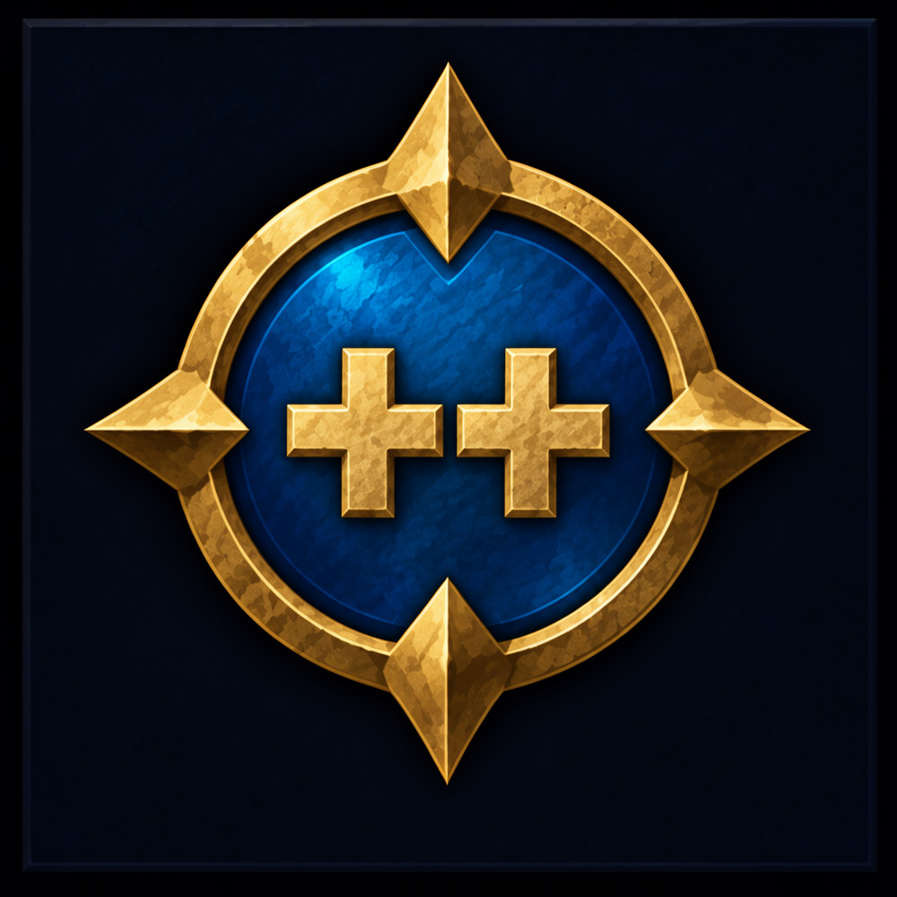

<p align="center"></p>

# Forever++

A World of Warcraft addon for **WoW: Forever** that adds to and changes the default UI in small, separate modules. It doesn't replace the UI: every change is meant to look like Blizzard shipped it, needs no setup, and can be turned off on its own.

Download it from [CurseForge](https://www.curseforge.com/wow/addons/foreverplusplus) or [Wago](https://addons.wago.io/addons/foreverplusplus), or [watch the 80-second trailer](https://www.youtube.com/watch?v=D_k53X4MYo0).

## Modules

Everything is on by default except where noted. Each module can be turned off, and most have options.

| Module | What it does |
|---|---|
| **Automation** | |
| Auto Decline | Turns down duel requests, and optionally party invites, guild invites, and guild charters, and says in chat who asked. Can let friends and guildmates through for duels and party invites. Off by default. |
| Auto Dismount | Gets you off your mount or stands you up when a spell, flight, loot, or attack fails because you're mounted or sitting. Can also leave shapeshift forms (off by default). |
| Auto Gossip | When an NPC has only one thing to say, or one service beside small talk, and no quests, picks it for you, so the bank, shop, trainer, or flight map opens straight away. Hold the Skip Key (Shift, Ctrl, Alt, or none) to choose yourself. Off by default, and so is its Other NPCs option. |
| Auto Release | Releases your spirit when you die in a battleground, unless you can resurrect yourself or someone is resurrecting you. Hold the Skip Key (an option, None by default) to stay where you fell. Off by default. |
| Auto Screenshot | Takes a screenshot when you level up, earn an achievement, or defeat a boss, and can for good loot, reputation, PvP ranks, titles, battlegrounds, and deaths. Can hide the interface for the shot, and for the ones you take with the Screenshot key too, and can show your `/played` time when you level up. Off by default. |
| Auto Open Containers | Opens the containers in your bags (clams, sacks, lockboxes once they're unlocked) by themselves, one at a time, and says in chat what it opened. It waits out combat, stealth, casting, and any loot, merchant, mail, bank, trade, or auction window, keeps the bag slots free that you pick (4 by default), and leaves raid sacks of gems, holiday gifts, and a few trunks and crates for you unless Open Special Containers is on. Off by default. |
| Auto Repair | Repairs your gear at any merchant who repairs and says in chat what it cost. Hold the Skip Key (Shift, Ctrl, Alt, or none) to skip it. |
| Auto Sell Junk | Sells the gray items in your bags when a merchant opens and says in chat what they sold for. Can stop at what the buyback list has room for, so anything you sold yourself stays buyable, and says how many were left unsold. Hold the Skip Key (Shift, Ctrl, Alt, or none) to skip it. Off by default. |
| Auto Stow | Puts your weapons away once they've been out for a few seconds out of combat, whether a fight left them out or you drew them yourself (pressing Sheath starts the delay again). Melee and ranged alike. |
| Auto Weapon Buff | Right-clicking a sharpening stone, weightstone, oil, poison, or fishing lure in Blizzard's bags, or using one from an action bar, puts it straight onto your weapon. Anything else you put on a weapon by hand works this way from then on. Not in combat. Main hand first; the off hand when only it can take it, or when its buff is missing or runs out sooner. When no equipped weapon can take it, it says so in red (Warn When No Weapon Fits, on). Off by default. |
| Comprehend Scrolls | For Mages: right-clicking a scroll you read with Comprehension ("Scroll: CHAP BALK WELLES") in Blizzard's bags casts Comprehend Scroll on it, without opening the spellbook. Not in combat, when the bags work as usual. Does nothing for characters without the spell. |
| Fishing Cast | Double right-click in the world with a fishing pole equipped to cast Fishing, and the click after that loots as usual. Never while in combat, and it warns you once when combat starts with the pole still equipped. Off by default. Its Louder Bobber option (off by default) turns sound effects up and music down while you fish, and puts your volumes back after. |
| Fast Loot | With auto loot on, takes everything at once instead of waiting for the loot window. |
| Gathering Tracking | Keeps Find Minerals or Find Herbs on after logging in, zoning, or dying, and can swap between the two. Say When Turned Back On (off by default) tells you in chat once it has. |
| Skip Cinematics | Skips cinematics and movies you've already seen on any character, or every one. Hold the Watch Key (Shift, Ctrl, Alt, or none) to watch. Off by default. |
| Auto Quest | Accepts quests and turns in finished ones as you talk to quest givers, going through a quest giver's list one by one. Never picks a reward when there's a choice, skips shared quests unless you allow them, and pauses while you hold Shift (or another key). Off by default. |
| **Character** | |
| Buff Timers | Shows the time left under your buff and debuff icons as a clock, like 1:23, instead of rounded minutes like 2 m: under 10 minutes (the default), under an hour, or always. When the game hides an aura's time in combat, Blizzard's own timer shows. Sort Buffs (off by default) orders your buffs by time left, the next to run out on the left or right and buffs that never run out at the other end. Hide Tracking Buffs (off by default) leaves minimap tracking, such as Find Herbs and Find Minerals, off the buff bar. On by default. |
| Macros | Makes macros in your general macros, shared by your characters and kept up to date, each with its own checkbox, and deletes a macro when it's turned off. Smart Buff casts the buff your friendly target (or you, with none) should get from you, at the best rank you know that they can take: Blessing of Might for Warriors and Rogues and Wisdom for mana users, Fortitude, Arcane Intellect, and so on, with your talent tree deciding for yourself. It never replaces one of your Blessings on them, and skips buffs they already have, or a stronger one like a Greater Blessing or Arcane Brilliance, until they're about to run out (Recast Below, 50% of the buff's length by default). When the target can't get anything from you, it buffs you and says why; with nothing left for either, its button shows a red X. Macros can't change in combat, so there it warns when it would cast the wrong buff for a new target. Its Pick Up button puts the macro on your cursor. Off by default. |
| Spell Ranks | Marks the spells on your action bars that have a higher rank you already know, with a warning badge (its corner, size, and padding are options) or a red tint over the button, and says the best rank in the spell's tooltip. `/fpp ranks` lists them. |
| XP Bar Text | Shows your experience on the experience bar all the time (or only under the mouse), with the percent, your rested XP, and the XP of your quests ready to turn in (or all of them), in green once turning them in would level you. It can fill the bar in green with that quest XP, like rested XP (on by default), adds XP left, XP per hour, and time to level to the bar's tooltip, and can show XP per hour and time to level on the bar too (off by default). On by default. |
| Character Window | Moves the Character window's Equipment, Titles, and Pet tabs to the side with the Reputation and Skills tabs, removes the portrait above the stats, shows your level and name in your class color as the title, and puts a small durability bar beside each item (always, only when worn, below 50% or 25%, or off). Can also color the Skills tab's bars green for the weapons you have equipped. Options for each. On by default. |
| Durability Warning | Warns you once when an item you wear drops below the durability you pick (25% by default), and again when one breaks, so you repair in time: red text in the middle of the screen, and if you turn them on, a chat line naming the item and a sound you pick, each with its own option. It warns again only after a repair. |
| Talent Planner | Adds a Plan Talents button to the talent window. While planning, clicking a talent adds a point to a saved plan instead of learning it (right-click takes one out, Shift for every rank), in the order you click, and a Level box limits the plan to the points you have at that level. Tooltips say at which level each rank comes, and the plan's next talent glows gold when you have a point to spend. Level-Up Reminder (off by default) names it in chat when you gain a point. A dropdown keeps several named plans per character and spec, and shares one as a line of text another character of the class can import. Import also takes a build link from talentsforever.com or wowforevertalents.com, in the link's order when it has one, or else one tree at a time from the top, the tree with the most points first; a link made on a talent tree that isn't the same as yours is refused. On by default. |
| Professions | Adds to the professions window, each part with its own checkbox. **Recipe Colors**: colors recipes by your chance of a skill-up: orange, yellow, green, or gray, with the row's highlight to match. **Skill-Ups Left**: a number on each row, and a line under the selected recipe's name, say how many skill-ups it has left before it turns gray (or the skill it turns gray at). **Skill Bar**: a bar under the selected recipe's name of the skill levels it turns yellow, green, and gray at, with your skill marked on it, so you can see how long it's worth crafting (Levels on Bar writes the levels on it; an estimate from the game's data). **Crafting Costs**: a recipe's reagent cost, the crafted items' worth, and the profit after the auction house's 5% cut, from Item Tooltips' Auction Prices and the merchant prices it learns, and each recipe's profit on its row of the recipe list too (Profit in Recipe List). **Unlearned Recipes**: Show Learned and Show Unlearned come back to the recipe list's Filter menu, for the recipes you know, the ones you don't, or both: with Show Unlearned ticked (it's off by default), the profession's recipes you don't know yet are in the list itself, in their categories among the ones you know, each with the skill it takes to learn (green now, yellow within 25 points by default (Soon Means Within), red later), and the recipe's page names the recipe item that teaches it, with its auction price and whether it's in your bags. The menu's Unlearned submenu filters them by source (Recipe Items, Trainers and Others), by when you can learn them (Now, Soon, Later, and Unknown: a trainer recipe's skill is learned the first time you open its trainer), and to those whose item you carry (Recipe in Bags). On by default. |
| Macro Icon Search | Adds a search box to the macro window's icon picker: type part of a spell's or item's name and it shows the icons of the spells you know and the items you carry or wear that match. |
| **Chat** | |
| Chat Copy | Adds a button beside the chat window (in the speech bubble's menu on a chat window too short for it) that opens the chat in its colors, already selected, so you can copy it as plain text with Ctrl+C (a Select All button selects it again). Its Click Timestamps option (off by default) lets you click a chat line's timestamp to copy that line. |
| Chat Levels | Shows each player's level before their name in chat, [60:Name], colored like a quest of that level against yours. The level is the last one Forever++ saw, so it shows for players far away too: it remembers the class, level, race, and guild of players in your group, your guild and friends, your `/who` results, and players you target, mouse over, or see a nameplate of, for 60 days. Off by default. |
| Quest Links | Makes the quests players with Questie link in chat, which reach everyone else as plain text like [[34] A Grim Task (304)], into Blizzard's quest links: click one to see the quest, as if they'd linked it from their quest log. |
| Short Channel Names | Shows chat channels as [1], [G], [LFG] (initials), or [General] (the name without its zone) instead of [1. General], alone or after the number, as number and initials ([3. T], [4. LFG]) by default, and [Guild], [Party], [Raid] and the like as [GD], [P], [R] (an option, on by default). Off by default. |
| Chat Font | Draws the chat windows in another of the game's fonts (Friz Quadrata, Arial Narrow, Skurri, or Morpheus), keeping their size, and optionally the chat input box too. Unavailable on Korean, Chinese, and Russian clients, whose chat font needs fallbacks. |
| Keep Chat Visible | Keeps chat text on screen instead of fading it out after a while. |
| Chat History | Keeps each chat window's latest lines, for each character, when you log out or reload and shows them again at login, except whispers. A slider sets how many lines, and a checkbox the line that marks where it ends. |
| Chat Arrow Keys | While you type in chat, Up and Down bring back what you sent before and Left and Right move through the text, without holding Alt. The arrow keys don't move your character while the chat box is open. |
| Social Button | Moves the social (Quick Join) button down beside the chat window's other buttons. |
| Whisper Window | Keeps whispers in a window of their own, like a messenger: conversations on the left with unread counts, and the one you pick on the right, under their name in class color with their level, race, class, guild, and zone, and a box to reply in (Shift-click an item to link it, Up and Down for what you sent; a long message goes as several whispers). Whispers from chat, Battle.net whispers, and away and busy replies join their conversation, saved for each character. New Whisper starts one, and right-click one to invite or remove it. `/fpp whispers` (or `/fpp whispers Name`) or a gold button beside the chat window that counts waiting whispers (on by default; on a chat window too short for it, it's in the speech bubble's menu, and the speech bubble counts them) opens it. It opens for whispers (on by default, after combat), can hide whispers from the chat windows (off by default), and fades while you move or fight. Drag it to move it and its corner to resize it. Off by default. |
| **Interface** | |
| Combat Alert | Floats a red "Entering Combat" or green "Leaving Combat" line up and away from the middle of the screen, each with its own checkbox, plus how long it stays and an optional sound (move and resize it in Edit Mode). Off by default. |
| Currency Bar | Shows your gold in a small tooltip-styled box, all three coins always, and optionally the currencies you tick Show on Backpack. Hovering it lists your gold and currencies with what this session gained or spent and your gold per hour. Options for the tooltip, the session figures, and a column layout (move and resize it in Edit Mode). Off by default. |
| Hide Error Messages | Keeps the red errors that repeat while you fight (Out of range, Not enough energy, Ability is not ready yet) off the top of the screen, along with their sounds. Hide picks Ability Errors (by default) or All Errors, which leaves only a few worth seeing, like full bags and a full quest log. Off by default. |
| Hide Stance Bar | Hides the stance bar (stances, forms, auras, stealth). Their keys in Key Bindings still work, and Show on Mouseover brings the bar back while the mouse is over it. Off by default. |
| Loot Rolls | Place the Need, Greed, and Pass rolls where you want in Edit Mode, with their scale, which way more rolls stack (up, down, left, or right), the gap between them, and how many example rolls show while you place them. Each roll also shows the seconds left and how many in your group picked each choice (each an option), and Appearance Icons, Already Known, and Unusable Items Tint mark them as they do your bags. Off by default. |
| Local Time | While the clock's Use Local Time is on, the calendar shows every time in your own time instead of the realm's: events in the month grid, a day's tooltip, an event's date and time, holidays, raid lockouts and resets, and when invitees answered. Events stay on the realm's day in the grid, with +1 or -1 after a time that's the next or previous day for you, and the create event window shows the time you picked in your time under its date. Guild events in the Communities window's calendar button and Guild News, and when auction money arrives in the mail, follow too. Use Local Time is in its settings as well. On by default; nothing changes until Use Local Time is on. |
| Movable Windows | Hold the move key (Shift by default, or none) and drag Blizzard's windows, like your character, spellbook, professions, friends, and bags, to put them where you want. Remember Position keeps them there always, only until you log out or reload, or never (back to their usual place when they close), and Reset puts every window back. Ctrl+Right-click a window to put just that one back (pick the click and key, or turn it off). Drag From lets a window be grabbed anywhere or only by its title bar. Windows with protected parts move only out of combat. Off by default. |
| Tooltips | Colors unit and item tooltips by class, reaction, or quality, colors the Horde or Alliance line red or blue, colors friends' tooltips in the friends list the same way, and adds player titles and who a unit is targeting. Can hide the health bar under unit tooltips (off by default), the fishing bobber's tooltip while you fish (off by default), and the quest lines (a quest's name and objectives) on player and NPC tooltips, or on objects such as chests too (shown by default). |
| Movable Framerate | Lets you move and resize Blizzard's framerate text (Ctrl+R) in Edit Mode, like Blizzard's own frames. Until you move it, it stays where Blizzard puts it. Off by default. |
| **Items** | |
| Already Known | Marks recipes, mounts, pets, toys, and other items you already know or have with a green check (or tint) on their icon, in the corner, size, and padding you pick, on merchants, the auction house, bags, mail, the loot window, and loot rolls, each with its own checkbox. |
| Appearance Icons | Marks gear whose appearance you haven't collected yet (the tooltip's "You haven't collected this appearance") with Blizzard's transmogrifier icon in a corner of its icon, top right by default, in your bags and bank, at merchants, in the auction house, and in the loot window and loot rolls, and on the row of a recipe that makes it in the professions window (at its right end, before the name, or after it), each with its own checkbox. Its corner, size, and padding are options, and a corner Upgrade Arrows or Already Known uses gets a warning. Hide Tooltip Line (off by default) takes the tooltip's own line out. |
| Bag Slot Counter | Shows how many bag slots are free on the backpack button, or each bag's own count on its button, with the reagent bag counted on its own. The count turns orange at 4 or fewer free (or the number you pick) and red at 0. |
| Easy Delete | Types DELETE for you in the box Blizzard asks for when you destroy a good item, so Yes is a single click. Off by default. |
| Item Tooltips | Adds lines to item tooltips, each with its own checkbox. **Sell Price**: the vendor price of the whole stack (hold Shift for one item). **Repair Cost** (off by default): what repairing damaged gear costs, without a merchant's repair cursor. **Auction Prices**: scans the auction house when you open it and shows the lowest buyout and how long ago it was seen (Hide on Junk leaves it off gray items), and prices Professions' Crafting Costs. With Auctionator installed, Use Auctionator's Prices uses its prices instead of scanning. **Item Count** (off by default): how many you own, in your bags and your bank. **Disenchant** (off by default): what disenchanting green, blue, and purple gear gives on average, priced from Auction Prices while that's on, or else the material it most likely gives; hold Shift for every outcome. Gear the game can disenchant into something not known yet says so, and learns it from your own disenchants. **Stat Colors**: each stat on gear in its own color, including Equip: bonuses like hit and spell power. **Compare Crafted Gear**: a recipe in your bags that makes gear compares it with what you wear, as gear does (gear you can wear at any level, or only from your professions). |
| Gathering Skill Tooltips | Shows the skill a herb, ore, skinnable beast, or locked lockbox or chest needs in its tooltip, colored like trainer recipes against your skill, and the skill that gathers herb, ore, and stone items. Gathering for professions you have, or always; Lockpicking only for characters who can pick locks, or blacksmiths with their skeleton keys. |
| Waylaid Crates | Helps fill Waylaid Crates. **Bundle Costs**: beside each bundle a crate takes, what buying it costs at auction (or under each one, or off), from Item Tooltips' Auction Prices. **Auction House Category**: a Waylaid Crates entry at the bottom of the auction house's categories (or the top, or off) that lists every item your crates still need, one row each, less what's already in your bags and bank. |
| Unusable Items Tint | Tints red the icons of items you can't use (class, armor or weapon skill, level, profession), going by the red lines in their tooltip, in your bags, the bank, and at merchants where the merchant doesn't already, and in the auction house and the loot window and loot rolls (those two off by default), each with its own checkbox. On by default. |
| Upgrade Arrows | Puts Blizzard's green arrow on gear that beats what you wear, judged by stat weights for your class and the talent tree you have the most points in (or one you pick for each character, with a Feral Bear profile for Druids). It marks your bags and bank, merchants, the loot window and loot rolls, the quest reward that's the biggest upgrade, and the auction house, each with its own checkbox. A ring is judged against your weaker ring and a two-hander against both hands; with a two-hander on, a one-hander or off hand is judged with the best one in your bags for the other hand. Pick the arrow's corner, size, and padding, and show the percentage beside it if you like; the tooltip shows both beside the item's name or on an Upgrade line. Show Scores adds every item's score, Show Downgrades marks worse gear with a red arrow, Higher Level Gear judges gear up to 5 levels (or as many as you pick) above yours, with a gray arrow for gear you can't wear yet, Ignore Profession Tools and Ignore Reagent Bag leave those unmarked, and a Threshold slider hides small differences. The weights start from a template per talent tree, worked out from what the game says a point of each stat gives your class and from Classic's stat values ([docs/stat-weights.md](docs/stat-weights.md)). Its Stat Weights page (`/fpp weights`) has a slider per stat, per profile, and Import and Export of Pawn strings. Off by default. |
| **Map** | |
| World Map | Adds to the world map in four parts, each with its own Enabled checkbox. The map's filter menu has quick checkboxes for Dungeons, Raids, Flight Masters, Boats and Zeppelins, Unexplored Areas, and Zone Info. **Points of Interest** shows dungeons, raids, capital cities, flight masters, boats, zeppelins, and spirit healers, each with its own checkbox (for capital cities, a choice of ours, Blizzard's, or none), icon size, and whether it shows on continent maps. Clicking a dungeon or raid opens its map in the DungeonJournal addon, if you have it. Skyborne ley lines and elemental convergences show too, saved as a Skyborne finds them (to Skyborne by default, everyone, or no one). **Zone Info** shows a panel in a corner of the map (bottom left by default) with the zone's level range colored against yours, who holds it, its dungeons, the fishing skill it needs, and the herbs, ore, and skinning in it; on a continent map, it's the zone under the cursor. Each line can be off, shown with the profession, always, or only while you hold the detail key, and the panel can sit in any corner or the middle of any edge, with size and opacity sliders. With Fold Button on, a minus button on the panel folds it down to the zone's name, or only the button, when it covers the map, and the plus button opens it again. **Unexplored Areas** shows the parts of zone maps you haven't explored yet, tinted in a color and strength you choose. **Coordinates** moves the game's map coordinates into the world map's title bar, yours on the left and the cursor's on the right, with checkboxes for player coordinates, cursor coordinates, and tenths that are Blizzard's own Interface settings. |
| Flight Timer | Times every flight you take, remembered by the game's flight point IDs, then shows a bar counting the flight down (move and scale it in Edit Mode) and the time on the flight map's tooltip. Before you've flown a route, Estimated Times (on by default) shows the time the game's own flight paths give it, marked with ~, until your own time replaces it. Sound on Landing (off by default) plays a sound a few seconds before you land. |
| Gathering Map | Remembers every herb, vein, treasure chest, and fishing pool you gather, open, or fish, for all your characters, and shows them on the world map as the icon of what they give (a circle in green or orange for one whose item isn't known yet, a chest for a chest, and a pool's most caught fish) and on the minimap. Gathering a node again counts it and moves its icon toward where it really is, and its tooltip on the world map says how often and when you last gathered it. A spot that spawns either of two veins (Tin or Silver, Iron or Gold, Mithril or Truesilver) is one node, shown as the one you've gathered most, with the other in its tooltip. A node you just gathered shows for 5 minutes by default as an empty ring on the minimap and its faded icon on the world map (each map's Just Gathered: faded icon, empty ring, hidden, or as usual, at the opacity you pick; for 1 to 30 minutes). On the minimap, a remembered node shows its icon, and within 150 yards of you by default it becomes an empty gold ring at 70%, so the game's own tracking dot shows inside it when the node is up and the ring is empty when it's gone (Show Nodes As: empty rings near you, hidden near you, 10 to 200 yards, empty rings everywhere, or icons), and pointing at one shows its tooltip (Minimap Tooltips, on by default). Where icons overlap, only the one nearest you is drawn; Keep at the Edge (off by default) shows a node just past the minimap's edge on the edge; and a minimap an addon made square is followed too. A node's tooltip has its name and the skill it needs, then times gathered, last gathered, and another vein the spot has spawned, with how far it is and a reminder of how to forget it while you hold Shift; each line can show always, with Shift, or never. Shift+right-click a node's icon on either map to forget it, Shift+click one on the world map to put the map pin on it, or forget every node in your zone or everywhere with the buttons in its settings, where Clear also forgets the herbs and veins learned in game (their items and skills). Export there gives every remembered node as a line of text to share, and Import adds nodes someone shared to yours. Its own Gathering Map page in Settings lists every herb and vein under Herbs and Ore, which fold away, each with a checkbox to show or hide it for that character, and a checkbox for all herbs or all ore, which the world map's filter menu has too. Selecting a node shows the skill it takes, a checkbox each for the world map and the minimap, how often and when you last gathered it, the zones its spots are in, and a button that forgets them. Only My Professions (on by default) shows herbs only on a character with Herbalism and ore only on one with Mining; Only While Tracking (on by default) shows herbs on the minimap only while Find Herbs is on and ore only while Find Minerals is; the world map shows them either way. A node your skill is too low for is gray by default (Too High for You), and one that no longer gives skill-ups shows as usual (No Skill-Ups); either can be as usual, gray, or hidden. A herb or vein you try before your skill is high enough is remembered too, as not gathered yet. Icon style (item icon or circle), a gold ring (on by default), and how solid the empty rings are (70% by default) are options, and the minimap and world map each have their own checkbox, icon size, and opacity, with continent maps (off by default) for the world map. On by default. |
| Hide Filter Reset | Hides the reset button on the world map's filter dropdown, which otherwise shows whenever a filter is off. |
| Square Minimap | Makes the minimap square, with a border in Blizzard's art in place of its round frame (Gold by default; or Metal, Diamond, Wood, Faction (Alliance or Horde), Dragon Isles, Oribos, Stone, Achievement, Thin, or none, with a Border Size). The map moves up to the zone name and buttons above it (Space Above sets how close), and the day and night indicator drags anywhere with Shift held (Move the Sun picks the key). The mail icon sits in the map's top left corner (Mail Icon picks another corner, or Blizzard's place). Forever++'s minimap button and minimap icons, and most other addons' minimap buttons, follow the square edge, and a click in a corner pings the map there. Turned off, the minimap is round again; an addon that already shapes the minimap is left to it. Off by default. |
| Waypoints | `/way [zone] x y [note]` puts the game's own map pin on a spot and tracks it (`/way 45.2 67.8`, `/way Elwynn Forest 45 67 Hogger`, or `/way clear`), with the note under the arrow; `/way share` puts the pin's link in the chat box to send to your group. TomTom's `/way` wins if it's installed. Waypoint Arrow (on by default) adds an arrow on screen that turns toward the pin, with the distance under it (move and resize it in Edit Mode). It can point to the quest selected on the map instead, with its name (on by default), and to your corpse while you're a ghost (on by default). Clear Pin on Arrival (on by default) takes the pin away once you're within 10 yards of it. On by default. |
| Compass Bar | A compass across the top of the screen that turns as you turn, with letters (all eight, or N, E, S, W), dots or lines, and degree numbers, in a frame or a shade, and Heading if you want it. The quest selected on the map, your map pin, your corpse while you're a ghost, and your group sit on it in the direction they are, with how far away. Quests can show every quest on the map instead, and Flight Masters, Gathering Nodes (from Gathering Map), and Rares and Treasures can be turned on. Max Distance (500 yards) leaves off what's farther, and Edge Arrows keep what you're heading for at the end of the bar while it's behind you. Set its width, height, and scale in Edit Mode. In Combat can fade or hide it, and Hide When Empty hides it while nothing's on it. It hides in dungeons and raids, where the game doesn't say which way you face, and on flight paths (Hide on Flight Paths). Off by default. |
| **Quests** | |
| Best Quest Reward | Puts a gold coin on the quest reward choice that sells to a vendor for the most (price times count), in the quest window and the quest log. Ties are all marked; it never picks for you. |
| Quest Tracker | Restyles Blizzard's quest tracker rather than replacing it, so Edit Mode, its menus, and quest items work as before. Options for the font and outline (the text size stays Edit Mode's), a dark box behind it that fits your quests (opacity, border, and padding), fading it in combat (and how faint), sorting tracked quests by level, lowest or highest first (off by default), and showing only the tracked quests of the zone you're in (off by default). On by default. |
| Forever Quest Icons | Marks quests that are new to Forever (not in original Classic) with the Forever logo in blue by default (or in its own color or gold), or the blue Forever medallion, an infinity sign, a WoW coin, or a star, after their name in the quest log on the world map, the objective tracker, a quest giver's list of quests, and the title of a quest's details, each with its own checkbox and icon size slider. On by default. |
| Quest Levels | Shows a quest's level before its name, like the quest log's [12] (with a + for elite quests), in a quest giver's list and at the top of the quest's details. On by default. Its Color by Difficulty option (off by default) colors the level gray through red by how it compares with yours. |
| Quest Pins | Needs the [QuestieDB](https://github.com/Questie/questiedb) addon (red and locked in the list without it). A ! on the world map where each quest you can still take starts, colored for normal, repeatable, dungeon and raid, class, profession, and holiday quests (or by difficulty, or all yellow), with the quests an NPC offers or waits for in its tooltip. Shift+click a pin sets a map pin there, Shift+right-click hides it. Options pick the kinds of quest (also from the map's filter menu), whether low-level quests are hidden or faded, how far above your level to hide them, upcoming quests a few levels ahead (faded), a reputation check, how nearby spawns are grouped, the pins' size and opacity, and what their tooltip says. Only as right as QuestieDB's data. Off by default. |
| Quest Item Sparkles | Makes quest items you can pick up in the world sparkle, so they're easy to spot. It keeps the game's own setting for that on, even after a graphics preset turns it off, and puts yours back when you turn the module off (the sparkle then stays until you restart the game). Off by default. |
| Quest Nameplates | Shows a quest icon that matches the objective (kill, item, or interact) and your progress (3/8, or how many are left) beside the health bar of creatures you need for a quest. In a party it can count everyone's progress added up, or the member furthest from done. |
| **System** | |
| Hide Beta Feedback | Hides the beta's "Press F6 to submit an issue" tooltip line, bug report button, and quest window feedback buttons. Off by default, and only on beta and PTR clients. |
| AddOns List | Shows the AddOns list without category headers, enabled addons first, each in name order. Options for ungrouping disabled addons, searching notes, and saving addon sets to turn back on later (off by default). On by default. |
| Error Catcher | Catches Lua errors, blocked actions, and Lua warnings quietly instead of in Blizzard's error popup, and keeps them per session with how often each happened, its stack, and its locals (for a blocked action, which has none, what was going on: combat, the instance, what the mouse was over, and the menus open). A Taint Log checkbox turns on the game's log of which addon caused one. A window (`/fpp errors`, or Shift-click the Minimap Button) lists them and has a Copy Bug Report button with the addon version, client build, modules on, and the error. Can print a chat message for each new error, or play a sound of your choice (both off by default). When another addon such as BugGrabber catches Lua errors, it leaves those to it. On by default. |
| Minimap Button | A Forever++ button on the minimap, in the addon compartment, or both. Right-click it to open Forever++ settings, or click it (the other way round with Click Opens Quick Toggles turned off) for a menu of quick toggles for the automation modules, like Auto Repair, Auto Sell Junk, Fast Loot, and Skip Cinematics, for Player Nameplates and NPC Nameplates, and for Gathering Map and the kinds it shows (herbs, ore, and fishing pools only with the profession), opening to either side of the cursor (Menu Side). The Customize button in its settings (also at the bottom of the menu) adds any other module to the menu, by category, or takes one out, and Menu Order lays the menu out by activity (the default), by category, or A to Z. While Error Catcher is on, it shows how many errors this session caught: Shift-click to see them, Ctrl-click to clear this session's, or Alt-click to clear them all (each key is an option). Drag it anywhere on or around the minimap (Reset Position puts it back on the edge). On by default. |
| Slash Commands | Adds short slash commands, each with its own checkbox: `/rl` reloads the UI, and `/clear` empties the chat window you type it in. A command another addon already has is left to that addon. `/fpp` is always there. On by default. |
| Console Variables | A page in Settings to browse and change the game's console variables (CVars), with a Popular group of the ones players look for under plain names (camera distance, screen glow, nameplate range, and more), a star to keep the ones you use in Favorites, and a padlock that keeps one at its value, put back at every login (some, like the simplified nameplate size, go back to their default) and whenever something else changes it, listed under Locked. Off by default; off, the page and `/fpp cvar` are gone and locks aren't kept. |
| Debug | Every module's debug options and the testing tools (Self Test, Gear Probe, Screenshots), on a Debug page of its own in the Settings sidebar. Off by default; off, the page and those tools' commands are gone, and every debug option is back at its default. |
| CPU Profiler | A page in Settings that records how much CPU each module takes, heaviest first, beside Forever++'s total CPU and memory. A module folds open to show what each of its parts takes and what its time went to by source (an event, a hook, an update), the worst frames are listed as spikes with whose call they were, and Copy gives it all as one line for a bug report. Nothing is timed until you press Record. Off by default; off, the page and `/fpp profiler` are gone and nothing is timed. |
| **Units** | |
| Class Colors | Shows players' health bars, and optionally names (class color or white) and target and focus name backgrounds, in their class color on the player, target, focus, party, and target-of-target frames, and hostile and neutral NPCs' health bars in red and yellow. Also colors online friends' names in the friends list and names in the who list by class, and optionally offline friends' names by the class Forever++ last saw them as (on by default). |
| Druid Mana Bar | Druids only: shows your mana under the energy or rage bar on the player frame while in Cat or Bear Form (or in every form, off by default), in the frame's own slot for a third bar, in a lighter blue, with text that follows the game's Status Text setting (or none). |
| NPC Nameplates | Always shows friendly NPCs' names with their title, with name and level size sliders, an optional level badge, and a choice of where buffs sit. The health bar appears only when they're hurt or in combat (or always, only in combat, or never). Players' pets, totems, and companions can keep Blizzard's plate. |
| Player Nameplates | Always shows friendly players' names with their guild, with name, level, and icon size sliders, an optional level badge, a choice of where buffs sit, and an icon (or light blue name) for recent allies. Players outside your group, guild, and friends are dimmed a little (Dim Other Players), and Class Icon and Lighter Rogue Yellow (both off by default) help tell players from neutral NPCs. The health bar appears only when they're hurt or in combat (or always, only in combat, or never). In dungeons and raids the game doesn't let addons change friendly nameplates, so there they're Blizzard's own, with health bars, or only the name with Names Only in Dungeons (off by default). |
| Simplified Dungeon Nameplates | Turns on the game's Simplified nameplates only inside dungeons and raids (and battlegrounds, if you pick that), for the kinds you tick: friendly players and friendly NPCs by default, minions and minor enemies if you want. Outside, your own nameplate settings come back. Off by default. |
| Target Markers | Hold a key and a ring of the raid icons opens at your mouse, like the ping wheel: point toward one and let go to mark your target (or the unit under your mouse), or let go in the middle to clear it. Hold Shift as you let go to place that icon as a world marker instead. The key is in Key Bindings under Forever++, and works in combat. Off by default. |

## Install

1. Get it from [CurseForge](https://www.curseforge.com/wow/addons/foreverplusplus) or [Wago](https://addons.wago.io/addons/foreverplusplus), or download the zip from the latest [release](https://github.com/xIGBClutchIx/ForeverPlusPlus/releases), or for the newest build, from the latest successful [Check run](https://github.com/xIGBClutchIx/ForeverPlusPlus/actions/workflows/check.yml) on `main` (under Artifacts; needs a GitHub login).
2. Unzip it into the Forever client's AddOns folder, for example `World of Warcraft\_forever_\Interface\AddOns\`, so you end up with `AddOns\ForeverPlusPlus\ForeverPlusPlus.toc`.
3. Start the game, or `/reload` if it's already running.

## Use

Open Game Menu > Options > AddOns > Forever++ (or type `/fpp`). It opens on the Modules page: every module with a checkbox, grouped by category, with a search box at the top that narrows the list by name, description, and options and a New checkbox beside it that shows only modules marked NEW; click a module to see what it does and its options beside the list. Profiles, right under it, gives characters sets of settings of their own: everyone starts on Default, used by every character, and a profile you make (a copy of another, from the defaults, or from Developer's Defaults, which it then follows as updates change it) holds which modules are on, their settings, where you put Forever++'s frames in Edit Mode and windows with Movable Windows, and the Minimap Button's quick toggles (not auction prices, gathering nodes, players seen, or what each character keeps of its own). Pick which profile this character uses and which one new characters start on, check characters onto a profile (another character takes it at its next login), rename and delete profiles (their characters go back to Default), and Export a profile as a line of text or Import one someone shared, as a new profile or over the selected one. Switching is live, with no reload, and waits for combat to end; with more than one profile, the Modules page says which one it changes and the Minimap Button's menu has a Profile submenu. Console Variables, Profiler, and Debug (each while it's on) are their own pages, Debug's with sections for What's New (buttons to reset the version you last saw and the welcome), Diagnostics (copy debug info, print each module's events, and reload), Tools, Previews, and Layout (Self Test, Gear Probe, Screenshots, Test Error, Whisper Window's Test Conversation, Chat Levels' Test Chat, Flight Timer's Test Flight, Combat Alert's Test Alerts, and nameplate and quest icon checks, for seeing a module without what it waits for), and Logging (options that print what a module does in chat), and Changelog has what changed in each release, with a search box and a By Module checkbox (on by default) that groups the notes under their modules (also in [CHANGELOG.md](CHANGELOG.md)). About has the version, links, and commands. The Defaults button at the top right of Modules, Changelog, and About offers two choices, for the profile in use: Recommended Defaults puts every module's settings back to how they start, and Developer's Defaults does that and also turns on Fishing Cast, Skip Cinematics, Auto Screenshot, Currency Bar, Hide Beta Feedback, Short Channel Names, Easy Delete, Auto Weapon Buff, Whisper Window with Hide Whispers in Chat, Upgrade Arrows, Macros, Movable Windows, Console Variables, Profiler, Debug, and Auto Gossip with its Other NPCs, sets World Map's Zone Info Dungeons and Fishing to Hold Detail Key, turns on Chat History's divider line, sorts Quest Tracker lowest level first, and opens the Minimap Button's menu to the left. Developer's Defaults also bases the profile on that preset (Based On on the Profiles page, where None stops it and keeps what the profile has), so what a later update adds to it reaches every setting you haven't changed yourself; Recommended Defaults bases it on none. A setting you change stays changed, even if a later update changes its default; only its undo arrow, Defaults, or `/fpp reset` puts it back. When a module needs one of Blizzard's own settings on, its options say so with a Turn On button.

| Command | What it does |
|---|---|
| `/fpp` | Opens the Forever++ settings (`/forever++` works too). |
| `/fpp list` | Lists the modules and whether each is on, and the commands (`/fpp help` too). |
| `/fpp toggle <module> [option]` | Turns a module on or off, or with an option, flips that checkbox. |
| `/fpp options <module>` | Lists a module's options and their values. |
| `/fpp set <module> <option> [value]` | Changes an option: `on`/`off`, a choice such as `/fpp set PlayerNameplates level after`, or a number such as `/fpp set WorldMap dungeonSize 150`. Leave out the value to see the choices. |
| `/fpp reset` | Asks, then puts every setting back to its default, clears what Forever++ saved, and reloads. |
| `/fpp profiles [name]`, `/fpp profile [name]` | Lists the profiles and how many characters use each, or with a name, switches this character to that profile. |
| `/fpp cvar [search]` | Opens Console Variables. |
| `/fpp profiler` | Opens the CPU Profiler. |
| `/fpp selftest` | Probes the client APIs Forever++ depends on and records events (flights, deaths, duels) until `/reload`; the log is saved in `ForeverPlusPlusDB.selfTest`. Also a button in the Debug module's settings; both only while Debug is on. |
| `/fpp weights` | Opens Upgrade Arrows' Stat Weights page in Settings (the Modules page while the module is off): Class and Tree dropdowns and a weight slider per stat, for your class or one you'll play later. |
| `/fpp buffs` | Shows how Macros' Smart Buff judges your friendly target (or you): each of your buffs with your rank for them, whether they have it (and whose), which buff it casts, and their buffs. Only while Macros is on. |
| `/fpp gearprobe` | Reads what the client says about the gear you wear and carry (stat tables, tooltip lines, item levels, its own item comparison), your talent tabs, and your stats, for the developers of the upgrade arrows; the log is saved in `ForeverPlusPlusDB.data.GearProbe` after `/reload`. Open your bags first. Also a button in the Debug module's settings; both only while Debug is on. |
| `/fpp shots [scene \| wait seconds]` | Takes screenshots of Forever++ in the game's own windows, one scene after another (`tooltip`, `map`, `bags`, `character`, `skills`, `talents`, `minimap`, `whispers`, `settings`), turning on the modules each shows just for its shot and putting them back after. It shows the tooltips, the Whisper Window (with the Debug module's made-up conversation), and Settings itself and asks you to open the map, bags, character window, and talents (opening those from addon code would taint them), taking each picture once the window is open. Name a scene to take only that one, or `wait 5` to take the screen as it is after a countdown. Saved as full-quality JPG in the game's `Screenshots` folder (each under 2 MB for CurseForge). Also a button in the Debug module's settings; both only while Debug is on. |
| `/fpp errors` | Shows the errors Error Catcher caught. |
| `/fpp questpins [hidden \| unhide <id\|all> \| why <id>]` | Lists the quest pins this character hid, brings one or all of them back, or says why a quest is pinned or not (Quest Pins). |
| `/fpp ranks` | Lists the spells on your action bars that have a higher rank you know (Spell Ranks). |
| `/fpp scan` | Scans the open auction house now. |
| `/fpp resetprices` | Forgets the saved auction prices. |

Settings are saved per account in `ForeverPlusPlusDB`, every profile with them (which one a character uses is saved for that character), players seen (for Chat Levels and Whisper Window) per account in `ForeverPlusPlusPlayersDB`, and what belongs to one character (talent plans, learned flight points, Quest Tracker's zone-hidden quests) in `ForeverPlusPlusCharDB`.

## For addon authors

Other addons can read what Forever++ knows through `ForeverPlusPlusAPI.v1`: auction prices (its own or Auctionator's), what disenchanting an item gives and is worth, Upgrade Arrows' scores for any item, flight times, the class, level, race, and guild of players it has seen, class and level colors, dungeon and raid level ranges, gathering skills, and each module with its options. They can also set, read, and clear the map pin by zone name, and get callbacks when prices, scores, modules, options, or the pin change. It's versioned, read only, and can't break the addon calling it. An addon can also add a module of its own, which shows on the Modules page with its options and follows profiles like a built-in one. See [docs/api.md](docs/api.md).

## Feedback

Bugs and ideas go in [GitHub issues](https://github.com/xIGBClutchIx/ForeverPlusPlus/issues).

## Contributors

Thanks to everyone who has added to Forever++ (also on the in-game About page):

- [cyberox](https://github.com/cyberox): Tooltips' Quest Lines option, which hides quest lines on unit and object tooltips, the Quest Pins module, which shows on the world map where the quests you can take start, and the first draft of the plugin API.

## Contributing

Forever runs the modern Retail client and API, not Classic Era, so read [AGENTS.md](AGENTS.md) first: it has the rules for this repository and how Forever differs. [docs/forever-api.md](docs/forever-api.md) records what's known about the client API. There's no build step; the addon is plain Lua loaded from the TOC.

For development, link the addon folder into the client instead of copying it, so edits show up after `/reload`. In a Command Prompt:

```
mklink /J "<WoW folder>\_forever_\Interface\AddOns\ForeverPlusPlus" "<this repo>\ForeverPlusPlus"
```

### Add a module

1. Create `Modules/<Category>/YourThing.lua` (the folder is its category: Automation, Character, Chat, Interface, Items, Map, Quests, System, Units, or Tools) starting with `local _, ns = ...`, and add it to the TOC after the other modules, before `API.lua`.
2. Call `ns.NewModule("YourThing", ns.L.YOURTHING_DESC, { enabled = true, ... })`. The description is its tooltip in Settings, and `module.title = ns.L.YOURTHING_TITLE` is the name shown there. Every string the player sees goes in `Locales/enUS/` (the file for its category), keyed with the module's name.
3. Do the work in `OnEnable` and undo it in `OnDisable`: modules turn on and off without a reload. A hook can't be removed, so use `self:Hook(object, "Method", fn)` (or `self:Hook("GlobalFunction", fn)`, or `self:HookScript(frame, "OnShow", fn)`): it hooks once and does nothing while the module is off. Events added with `self:On(event, fn)` stop by themselves, and so do timers made with `ns.Frames.Timer(module)` or `ns.Frames.Coalesce(fn, delay, module)`, so a module that only uses those and hooks needs no `OnDisable`. Events wanted only while an option is on go in `module:OnWhile("optionKey", { EVENT = fn })`, once at file load: Core listens while the module is on and the option isn't false or `"off"`. Don't also add those handlers with `self:On`.
4. Set `module.category` (`automation`, `character`, `chat`, `interface`, `items`, `map`, `quests`, `system`, `tools`, or `units`). A tool with nothing to turn off sets `module.alwaysOn = true` and gets no checkbox. A command only for while a module is on passes that module's name as `ns.AddCommand`'s last argument. A module only for some clients gives `module:IsAvailable()`. Set `module.added` to the version it first ships in (`"0.8.0"`) so the Modules page marks it NEW for players updating to that version; an option takes `added` the same way, or `changed` for the version it changed in.
5. Read settings from `module.db`. List options in `module.options` (`{ key, name, description }`, default in `defaults`): a checkbox, a dropdown with `choices = { { value, label }, ... }`, or a slider with `min`, `max`, `step`, and a `format` for its label: a format string such as `"%d%%"`, or a function of the value for labels like "Never". `requires = key` puts an option under a checkbox option, greyed out while that's off, `available = fn` greys one out while `fn()` is false (another addon it needs isn't loaded), and `slider = key` on a checkbox puts that slider in the checkbox's row, and `cvar = "name"` on a checkbox makes it one of Blizzard's own settings (it reads and sets that CVar, and saves nothing). Add `debug = true` to put one in the Debug module's settings instead, with `section = ns.L.DEBUG_SECTION_PREVIEWS` (made-up content), `_LAYOUT` (guides), `_LOGGING` (printing what it does), `_TOOLS`, or `_DIAGNOSTICS` for its section there, or a `section` (a locale string) to keep a long list in groups. React in `module:OnOptionChanged(key)`. Buttons go in `module.actions` (`{ name, button, description, fn }`, plus `confirm = "question?"` to ask before it runs), and buttons for testing in `module.debugActions` (the same, plus `whileOff = true` to keep one usable while the module is off, and a Debug `section`). If it needs a Blizzard setting (a CVar) on, `module.notice = ns.CVars.OffNotice(module, cvar, text, description)` warns in Settings while it's off.
6. Anything the module says in chat by itself goes through `module:Print`, with `chat = true` in `defaults` and `ns.ChatOption(description)` in `module.options`, so the player can turn it off.
   To be part of a preset such as Developer's Defaults, say what it does to the module: `module.presets = { developer = { enabled = true, options = { key = value } } }`. A profile based on that preset follows it, so what you add there later reaches players who haven't set it themselves.
7. To add to a module that is made of parts, like World Map, make a part instead: `local part = ns.modules.WorldMap:NewPart({ key, name, description, section }, defaults)` in a file of the module's folder, its options in `part:AddOptions({ ... })`. The part is written like a module (`OnEnable`, `OnDisable`, `OnOptionChanged`, `part:On`, `part:OnWhile`, `part:Hook`) and is on while the module and its own checkbox are; its settings share the module's `db`, so their keys must differ from the other parts'. Give the toggle `choices` (one of them `"off"`, and the default in `defaults`) to make it a dropdown row among the options instead of a section with a checkbox, like Waylaid Crates' parts: the part is on for any choice but `"off"`, and its `OnOptionChanged` hears when the choice changes.
8. For a page the module draws itself, give it `module:BuildPage(frame)`, and `module.pageTitle` to name it something other than the module; `ns.OpenSettings(module.name)` opens it. A module that turns on and off has its page in the sidebar only while it's on. `ns.AddCommand(name, usage, description, fn)` adds `/fpp <name>`.

Renaming or dropping an option is fine: stale saved values are cleared when the addon loads. When a release renames or merges a module or setting players chose, move their saved values with `ns.Migrate` (see `AGENTS.md`).
